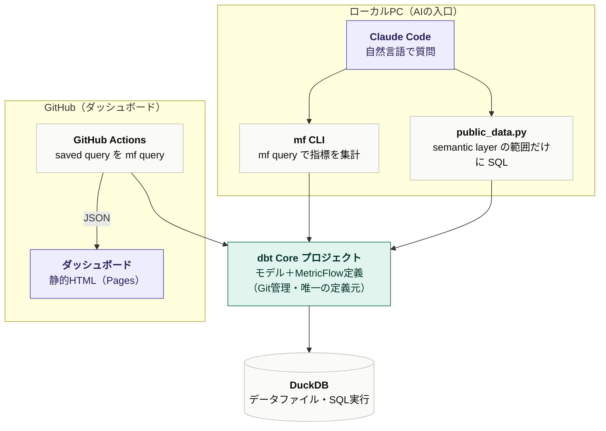

# dbt jaffle shop × MetricFlow

dbt 公式の jaffle shop のデータを使い、**指標の定義を MetricFlow の1か所にまとめ、静的なダッシュボードとローカルの AI 分析の両方から使う**構成にしたプロジェクトです。

**ダッシュボード: https://sr-56.github.io/dbt_jaffle_shop/**



- **ダッシュボード**: GitHub Actions が `mf query` で集計した JSON を、静的 HTML として GitHub Pages に公開します
- **AI 分析**: ローカルの Claude Code に自然言語で質問すると、定義済みの指標は `mf` CLI で、指標を超えた分析（分布、併売、コホートなど）は公開モデルへの SQL で答えます

指標の値はダッシュボードも AI も MetricFlow から出すので、同じ数字になります。ダッシュボードは saved query で選んだ指標の表示に専念し、AI はその外側の柔軟な分析を受け持ちます。AI が参照できるのは semantic layer に載せたもの、つまり semantic model になっているモデルの、entity か dimension にした列だけです（staging・seed・それ以外の列は SQL でも届きません）。「何を AI に見せるか」も、指標と同じ YAML で管理しています。

## 構成

| パス | 内容 |
|---|---|
| `seeds/` | 生データ（jaffle shop の CSV） |
| `models/staging/` | 型と列名の整形（金額はセント → ドルの decimal） |
| `models/marts/` | スタースキーマ（`fct_orders` / `fct_order_items` / `dim_*`）と time spine |
| `models/marts/_marts.yml` | semantic model と指標の定義（唯一の定義元）。ここで entity / dimension にした列が AI に公開される |
| `models/marts/_saved_queries.yml` | ダッシュボードに載せるデータセット |
| `scripts/export_metrics.py` | saved query を `mf query` で実行し、`site/data/*.json` に書き出す |
| `site/index.html` | ダッシュボード（ライブラリなしの HTML + SVG） |
| `.github/workflows/pages.yml` | build → 検証 → JSON 書き出し → Pages 公開 |
| `scripts/public_data.py` | AI に公開するモデル・列・指標の説明（`context`）と、公開モデルだけへの読み取り専用 SQL（`sql`） |
| `.claude/skills/analyze-data/` | Claude Code が分析するときの手順 |
| `docs/adr/` | 設計判断の記録 |

## 指標

| 指標 | 内容 | 粒度 |
|---|---|---|
| `revenue` | 売上（税込） | 注文 |
| `order_count` | 注文数 | 注文 |
| `average_order_value` | 平均注文単価（revenue ÷ order_count） | 注文 |
| `ordering_customers` | 注文した顧客数 | 注文 |
| `tax_paid` | 税額 | 注文 |
| `items_sold` | 販売個数 | 明細 |
| `product_revenue` | 商品売上（税抜の定価の合計） | 明細 |
| `supply_cost` | 原価 | 明細 |
| `gross_profit` | 粗利（product_revenue − supply_cost） | 明細 |

切り口: 月・四半期などの時間、店舗、商品・商品種別、顧客区分（new / returning）、フード・ドリンクを含む注文か。

## 動かし方

前提: [uv](https://docs.astral.sh/uv/)

```bash
uv sync
export DBT_PROFILES_DIR=.
uv run dbt build                 # seed → model → test
uv run mf validate-configs       # semantic layer の検証
uv run mf query --metrics revenue,average_order_value --group-by metric_time__month,store__store_name
```

ダッシュボードをローカルで見る:

```bash
uv run python scripts/export_metrics.py
python3 -m http.server -d site 8000   # http://localhost:8000
```

AI で分析する: このディレクトリで Claude Code を起動し、「Brooklyn の月別の粗利は？」「一緒に買われやすい商品の組み合わせは？」のように聞きます。

## 設計判断

[docs/adr/](docs/adr/README.md) を参照してください。
